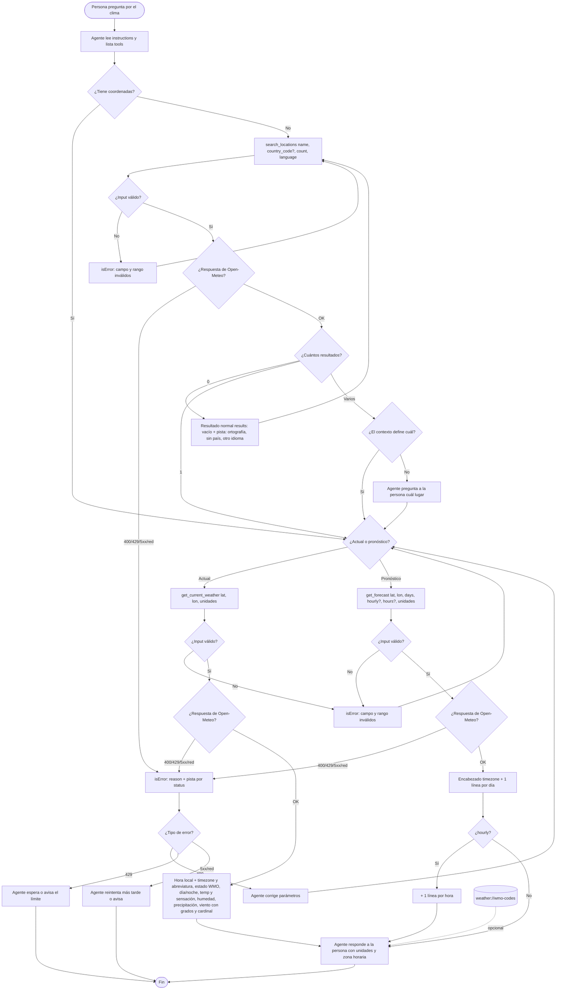

# Flujo de usuario — Información meteorológica con Open-Meteo

> Fuentes: `docs/funcional/informacion-meteorologica.md`, `docs/features/informacion-meteorologica/_contexto-repo.md` (ambigüedades ya resueltas por el orquestador) y `.claude/factory/convenciones.md`. No hay prototipo HTML.
>
> Adaptación al dominio: esto es un servidor MCP, no una UI. Las "pantallas" son **llamadas a tools/resources** y sus salidas (`content` de texto + `structuredContent`). El mecanismo de feedback es el resultado de la tool: normal con pista cuando no hay datos, `isError: true` con mensaje y pista accionable cuando algo falla. Todos los textos que ve el agente van **en inglés** (el repo no tiene i18n); los ejemplos de strings de este documento son orientativos.

## 1. Objetivo de la feature

Que una persona le pregunte a su agente (Claude Code, Claude Desktop u otro cliente MCP) "¿qué tiempo hace en X?", "¿llueve mañana en Y?" o "¿cómo viene el fin de semana en Z?" y reciba una respuesta correcta, con unidades y zona horaria, sin que nadie tenga que conseguir una API key. El agente resuelve el nombre del lugar a coordenadas, desambigua si hace falta y consulta clima actual o pronóstico en Open-Meteo.

## 2. Actores y permisos

| Actor | Rol | Permisos / restricciones |
|---|---|---|
| Persona usuaria | Hace la pregunta en lenguaje natural; eventualmente elige entre lugares homónimos. | No interactúa con el servidor directamente. |
| Agente LLM (cliente MCP) | Lee las `instructions` del servidor, llama a `search_locations`, `get_current_weather`, `get_forecast` y puede leer `weather://wmo-codes`. | Solo lectura. Todas las tools con annotations `readOnlyHint: true, destructiveHint: false, idempotentHint: true, openWorldHint: true`. |
| Dev que instala | Registra el servidor con `claude mcp add open-meteo -- node /ruta/absoluta/open-meteo-mcp/dist/index.js`; opcionalmente sobreescribe `OPEN_METEO_GEOCODING_URL` / `OPEN_METEO_FORECAST_URL`. | Uso gratuito **no comercial** (600 llamadas/min, 5.000/hora, 10.000/día); atribución CC BY 4.0 obligatoria. |
| Open-Meteo (sistema externo) | Dos hosts: geocoding (`/v1/search`) y pronóstico (`/v1/forecast`). | Sin auth. Devuelve 400 `{error, reason}` ante parámetros inválidos y 429 al superar límites. |

## 3. Happy path

### 3.0 Descubrimiento (al conectar)

1. El cliente MCP se conecta por stdio y recibe las **instructions** del servidor: primero `search_locations` para pasar de nombre a coordenadas (y desambiguar si hay varios), después `get_current_weather` o `get_forecast` con esas coordenadas; atribución "Weather data by Open-Meteo.com (CC BY 4.0)"; uso gratuito no comercial y sus límites.
2. El agente lista tools (3) y resources (`weather://wmo-codes`). Las descripciones de cada input (con sus rangos y defaults) le dicen qué puede pedir.

### 3.1 "¿Qué tiempo hace en Córdoba, Argentina?" (criterio 1)

1. El agente llama a `search_locations` con `name: "Córdoba"`, `country_code: "AR"` (defaults: `count: 5`, `language: "es"`).
2. **Salida**: una línea por lugar con nombre, provincia (`admin1`), país, coordenadas, timezone e `id`. Con el filtro de país viene un único resultado (Córdoba, Córdoba, Argentina, id 3860259). `structuredContent` trae los resultados completos.
3. El agente toma `latitude`/`longitude` del resultado y llama a `get_current_weather` (defaults: `celsius`, `kmh`).
4. **Salida**: un bloque compacto con:
   - hora de la medición (`current.time`, hora local sin offset) **junto con** la `timezone` y su abreviatura (p. ej. `America/Argentina/Cordoba (GMT-3)`);
   - estado del tiempo traducido del código WMO (p. ej. código 1 → `Mainly clear`) y si es de día o de noche;
   - temperatura y sensación térmica con unidad (`°C`);
   - humedad (`%`), precipitación (`mm`);
   - viento: velocidad con unidad + dirección en grados y punto cardinal de 8 puntos (p. ej. `230° SW`).
   Ningún número sin su unidad. `structuredContent` con el objeto completo.
5. El agente redacta la respuesta a la persona.

### 3.2 "¿Llueve mañana en Rosario?" / "¿Cómo viene el fin de semana en Bariloche?" (pronóstico)

1. `search_locations` como en 3.1 (con o sin `country_code`).
2. El agente llama a `get_forecast` con las coordenadas y un `days` acorde a la pregunta (default 7; 1–16).
3. **Salida**: encabezado con la zona horaria del lugar, luego **una línea por día** que empieza con la fecha `YYYY-MM-DD` y trae estado WMO en texto, mínima/máxima, precipitación total, probabilidad máxima de precipitación y viento máximo, todo con unidades.
4. Para una pregunta acotada en horas ("¿llueve esta tarde?") el agente pasa `hourly: true` y `hours` (1–48, default 24). La salida agrega, después de las líneas diarias, **una línea por hora** que empieza con `YYYY-MM-DDTHH:MM` con temperatura, probabilidad de precipitación y estado WMO. Diario y horario salen de una sola consulta.
5. Criterio 3: `days: 3` → exactamente 3 líneas diarias; `hourly: true, hours: 4` → además exactamente 4 líneas horarias.

### 3.3 Unidades alternativas (criterio 4)

1. En `get_current_weather` o `get_forecast` el agente pasa `temperature_unit: "fahrenheit"` y/o `wind_speed_unit: "mph" | "ms" | "kn"`.
2. La salida muestra los valores convertidos por Open-Meteo y las unidades que devuelve la API (`°F`, `mph`, `m/s`, `kn`), no las por defecto.

### 3.4 Consulta de la tabla WMO (opcional)

1. El agente puede leer `weather://wmo-codes` para interpretar estados o explicárselos a la persona.
2. **Salida**: markdown con la tabla completa de códigos (0 Clear sky … 99 Thunderstorm with heavy hail). Es la misma tabla que usan las tools para traducir `weather_code`.

## 4. Estados y variantes

| Estado | Dónde | Qué ve el agente |
|---|---|---|
| Éxito | Las tres tools | Texto compacto (una línea por lugar/día/hora) + `structuredContent` completo. Siempre con unidades y zona horaria en lo que tenga horas. |
| Vacío | `search_locations` sin coincidencias (Open-Meteo no trae `results`) | Resultado **normal** (no error), `structuredContent: { results: [] }`, con pista: revisar ortografía, probar sin `country_code`, o con el nombre en otro idioma. Ej.: `No locations found for "Cordova". Check the spelling, try without country_code, or try the name in another language.` |
| Ambiguo | `search_locations` sin país con nombre repetido | Se listan todos (p. ej. Córdoba AR / ES / MX, criterio 2) con provincia/estado y país, para que el agente elija por contexto o **le pregunte a la persona**. No se elige uno automáticamente. |
| Código WMO desconocido | Clima actual, diario, horario | Se muestra `Unknown (code N)`; la respuesta no se rompe. |
| Día / noche | Clima actual | Se indica explícitamente según `is_day` (la API no da unidad para ese campo). |
| Input inválido | Cualquier tool | `isError: true` antes de llamar a la API (validación de rangos/enums). Ver §5. |
| Error upstream | Cualquier tool | `isError: true` con el `reason` de Open-Meteo (si lo hay) + pista accionable según status. Ver §5. |
| Carga | — | No aplica: la llamada es síncrona para el agente; el único límite temporal es el timeout del backend (tratado como error de red). |
| Tamaños de pantalla | — | No aplica (no hay UI). La "variante" es salida compacta en texto vs. objeto completo en `structuredContent`. |

## 5. Flujos alternativos y de error

### 5.1 Desambiguación del lugar

1. `search_locations` con `name: "Córdoba"` sin país devuelve AR, ES y MX.
2. El agente:
   - si la pregunta o el contexto ya define el país, toma ese resultado (o repite la búsqueda con `country_code`);
   - si no, le pregunta a la persona cuál quiere, mostrando provincia/estado y país.
3. Continúa con 3.1 paso 3 o 3.2 paso 2.

### 5.2 Validaciones de input (rechazo antes de llamar a la API)

| Tool | Input | Regla | Resultado |
|---|---|---|---|
| `search_locations` | `name` | Obligatorio, no vacío | `isError: true` |
| `search_locations` | `count` | 1–20 | `isError: true` |
| `search_locations` | `country_code` | ISO 3166-1 alfa-2 | ⚠️ Ambigüedad: ver abajo |
| `search_locations` | `language` | Default `es` | ⚠️ Ambigüedad: ver abajo |
| `get_current_weather` / `get_forecast` | `latitude` / `longitude` | −90..90 / −180..180 | `isError: true` |
| ambas | `temperature_unit` | `celsius` \| `fahrenheit` | `isError: true` |
| ambas | `wind_speed_unit` | `kmh` \| `ms` \| `mph` \| `kn` | `isError: true` |
| `get_forecast` | `days` | 1–16 | `isError: true` |
| `get_forecast` | `hours` | 1–48 | `isError: true` |
| `get_forecast` | `hours` con `hourly: false` | Se ignora: no se piden datos horarios | Resultado normal, solo diario |

El mensaje de rechazo tiene que permitirle al agente corregir y reintentar solo (qué campo, qué rango).

⚠️ Ambigüedad: la doc dice que `country_code` es "ISO 3166-1 alfa-2", pero no si el servidor valida el formato (dos letras, mayúsculas/minúsculas) o lo pasa tal cual a Open-Meteo. Si no se valida, un `country_code` inválido podría terminar en vacío (pista normal) o en un 400 upstream en lugar de un rechazo previo.

⚠️ Ambigüedad: `language` no tiene valores permitidos definidos (¿cualquier string, una lista cerrada, código ISO 639-1?). Tampoco está verificado qué hace Open-Meteo ante un idioma no soportado.

### 5.3 Errores upstream

| Caso | Feedback (`isError: true`) |
|---|---|
| HTTP 400 | Mensaje con el `reason` original de Open-Meteo (p. ej. `Latitude must be in range of -90 to 90°. Given: 200.0.`) + pista "check the parameters" (criterio 5). |
| HTTP 429 | Límite de la API gratuita alcanzado + pista "wait before retrying". |
| HTTP 5xx | Fallo de Open-Meteo + pista "try again later". |
| Timeout / red | Sin status; pista "try again later". |

En todos los casos el handler devuelve `fail(...)`, nunca lanza. El agente decide si reintenta (5xx/red), espera (429) o corrige parámetros (400) y se lo comunica a la persona.

### 5.4 Casos borde

- **Consulta directa por coordenadas**: si la persona ya da coordenadas, el agente puede saltear `search_locations`. Las instructions lo recomiendan como paso previo, no como obligatorio.
- **Pregunta fuera del horizonte** ("¿llueve dentro de 20 días?"): `days` > 16 se rechaza en la validación; el agente explica el límite de 16 días.
- **Fuera de alcance v1**: datos históricos, calidad del aire, marino, inundaciones, uso comercial con API key, cache. Si la persona los pide, no hay tool para eso; el agente lo dice.
- **Valores faltantes en el pronóstico**: ⚠️ Ambigüedad: los fixtures no tienen valores `null` en los arrays `daily`/`hourly`, y la doc no dice cómo mostrarlos (p. ej. si Open-Meteo no da probabilidad de precipitación para días lejanos). Hace falta decidir el texto (¿`n/a`?) para no mostrar `null` ni un número sin unidad.
- **`hours` mayor que lo cubierto por `days`** (p. ej. `days: 1, hours: 48`): ⚠️ Ambigüedad: la doc no dice si las horas pueden pasar del último día diario pedido. Según el diseño de la request, `forecast_hours` y `forecast_days` son independientes, así que las líneas horarias podrían cubrir días que no aparecen en el diario.

## 6. Diagrama

